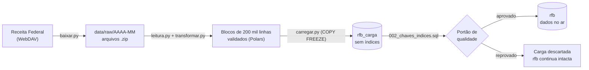

# Pipeline de dados abertos do CNPJ

[](https://github.com/victorhugofbr/pipeline-cnpj/actions/workflows/ci.yml)


Pipeline em Python que baixa, valida e carrega no PostgreSQL a **base completa do CNPJ**,
publicada todo mês pela Receita Federal como dados abertos: **mais de 220 milhões de linhas**
(empresas, estabelecimentos, sócios e Simples Nacional), em **30 a 45 minutos**, num computador
pessoal.

É um projeto de estudo de engenharia de dados com foco em **confiabilidade**. O pipeline pode ser
executado de novo a qualquer momento sem duplicar nem corromper dados, e os dados no ar só são
substituídos depois que a carga nova passa por um controle de qualidade.

## Destaques

- **Idempotente:** um diário de cargas (`etl.cargas`) registra cada execução. Se o mês já está
  carregado por completo, rodar de novo não faz nada; para reprocessar, basta `--forcar`.
- **Troca atômica:** a carga acontece numa área separada (`rfb_carga`) e só substitui os dados no ar
  (`rfb`) numa única transação. Quem consulta nunca vê dados pela metade.
- **Portão de qualidade:** a carga nova precisa ter pelo menos 90% das linhas da atual. Se não tiver,
  é descartada e os dados antigos continuam no ar.
- **Tratamento de falhas:**
  - downloads retomáveis (HTTP `Range`), com novas tentativas e espera crescente;
  - conferência de tamanho e CRC antes de aceitar cada arquivo;
  - trava no banco contra duas execuções simultâneas;
  - cargas interrompidas são detectadas e marcadas como `falhou` na execução seguinte.
- **Validação:**
  - o layout de cada arquivo é conferido, para detectar mudança de formato na fonte;
  - só um CNPJ inválido rejeita a linha; os demais campos inválidos viram `NULL` e são contados no
    relatório;
  - as linhas rejeitadas ficam guardadas para auditoria.
- **Deduplicação auditável:** quando a fonte traz a mesma chave repetida, fica a versão mais
  completa, e todas as versões vão para `<tabela>_duplicados`. Se as cópias passarem de 1%, a
  carga para.
- **Desempenho:**
  - leitura em blocos com Polars, com memória constante, sem descompactar no disco;
  - carga via `COPY ... FREEZE`;
  - chaves e índices criados depois da carga.
- **CNPJ alfanumérico:** CNPJ é sempre texto, pronto para o novo formato.
- **Testes:** 36 testes automatizados, sem acesso à rede nem ao banco (servidor simulado com
  `httpx.MockTransport` e arquivos sintéticos), rodando no GitHub Actions a cada push.

## Resultados (mês de referência 2026-10)

| Tabela | Linhas | Tempo de carga |
|---|---|---|
| `empresas` | 70.517.438 | ~4 min |
| `estabelecimentos` | 73.809.379 | ~12 min |
| `socios` | 28.495.961 | ~2 min |
| `simples` | 50.806.102 | ~2,5 min |

- **0 linhas rejeitadas** e 0 linhas malformadas.
- Chaves e índices: de 12 a 26 minutos. Atualização completa: de 30 a 45 minutos.
- Banco final: 34 GB.

## Como funciona



O `mensal.py` encadeia tudo: descobre o mês mais recente, consulta o diário para saber se ele já
foi carregado, baixa os arquivos e chama o `atualizar.py`, que faz a carga, os índices, o portão de
qualidade e a troca.

## Problemas reais que o projeto resolveu

- **Chave duplicada na fonte.** A primeira carga completa falhou porque uma empresa vinha duas vezes
  no arquivo da Receita: uma versão completa e outra "casca vazia". A regra passou a ser manter a
  versão com mais campos preenchidos, guardando todas para auditoria.
- **Quedas durante a criação de índices.** O Docker reiniciou no meio da criação de índices de 73
  milhões de linhas. A investigação passou por códigos de saída, logs e arquivos órfãos que o
  PostgreSQL não remove sozinho (3,65 GB). As correções contra a recorrência: `COPY FREEZE`, para o
  autovacuum não reescrever as tabelas logo depois da carga; reinício automático do banco; trava
  contra execuções simultâneas; e um diagnóstico de arquivos órfãos
  (`etl/sql/diag_arquivos_orfaos.sql`).
- **Consulta lenta mesmo com índice.** Buscar as 1.321 padarias ativas da Paraíba levava 1,5 s com o
  cache frio, porque cada linha estava numa página diferente da tabela de 15 GB. Com o cache quente,
  1,8 ms. A conclusão orienta o próximo passo: uma tabela de busca gravada em ordem física por região
  e segmento.

## Requisitos

- **Docker** (no Windows, Docker Desktop com WSL 2) e **Git**.
- **Python 3.12 ou superior.**
- **Disco:** cerca de 35 GB para o banco. Durante a troca mensal existem duas cópias, então o pico
  chega perto de 80 GB, mais uns 7 GB de `.zip`. Reserve pelo menos **100 GB livres**.
- **Memória:** desenvolvido num PC com 16 GB, com 6 GB reservados ao WSL.

## Instalação

```powershell
git clone https://github.com/victorhugofbr/pipeline-cnpj.git
cd pipeline-cnpj

# 1. Variáveis de ambiente: copie o modelo e troque a senha no .env
Copy-Item .env.example .env          # Linux/macOS: cp .env.example .env

# 2. Banco de dados (PostgreSQL 18). As extensões são criadas na primeira subida.
docker compose up -d

# 3. Ambiente Python
cd etl
python -m venv .venv
.\.venv\Scripts\Activate.ps1         # Linux/macOS: source .venv/bin/activate
pip install -r requirements-dev.txt
```

| Variável do `.env` | Para que serve |
|---|---|
| `POSTGRES_DB`, `POSTGRES_USER`, `POSTGRES_PASSWORD` | Banco, usuário e senha |
| `POSTGRES_PORT` | Porta no computador (padrão `5432`, aberta só para `127.0.0.1`) |
| `RFB_DAV_URL` | Opcional: troca o endereço WebDAV da Receita, se ele mudar |

## Uso

Dentro de `etl`, com o ambiente virtual ativado:

```powershell
python mensal.py                     # baixa e carrega o mês mais recente (se já carregado, não faz nada)
python mensal.py --forcar            # recarrega mesmo que o mês já esteja no ar
python mensal.py --apagar-zips       # apaga os .zip depois de uma carga bem-sucedida

python baixar.py --listar            # mostra os meses disponíveis na Receita
python baixar.py --mes 2026-10       # baixa um mês específico, sem carregar

python atualizar.py ../data/raw/2026-10                  # carrega uma pasta já baixada
python atualizar.py ../data/raw/2026-10 --manter-antigo  # guarda a versão anterior em rfb_antigo
```

| Opção do `atualizar.py` | Efeito |
|---|---|
| `--tolerancia 0.9` | Fração mínima de linhas, em relação à carga atual, para aprovar a nova |
| `--permitir-incompleto` | Aceita uma pasta sem todos os tipos de arquivo (útil em testes) |
| `--manter-antigo` | Não apaga a versão anterior depois da troca |
| `--linhas-por-bloco 200000` | Tamanho dos blocos de leitura (menor = menos memória) |

## Testes

```powershell
cd etl
pytest -q          # 36 testes: transformação, leitura, portão de qualidade e download
ruff check ..      # revisão de estilo e de erros comuns
```

## Estrutura do banco

| Schema | Conteúdo |
|---|---|
| `rfb` | Dados da Receita no ar, substituídos inteiros a cada mês |
| `rfb_carga` | Existe só durante a atualização |
| `etl` | Diário das cargas (`etl.cargas`): mês, início, fim, situação e contagens |

| Tabela | Chave primária |
|---|---|
| `empresas` | `cnpj_basico` |
| `estabelecimentos` | `cnpj_basico, cnpj_ordem, cnpj_dv` |
| `socios` | índice em `cnpj_basico` |
| `simples` | `cnpj_basico` |
| `cnaes`, `municipios`, `naturezas`, `qualificacoes`, `paises`, `motivos` | `codigo` |

Dica: para buscar um CNPJ completo, corte os 14 caracteres em três partes (`cnpj_basico`,
`cnpj_ordem`, `cnpj_dv`). Juntar as colunas dentro do `WHERE` impede o uso da chave primária.

## Estrutura de pastas

```
pipeline-cnpj/
├── .github/workflows/ci.yml    # testes e revisão de estilo a cada push
├── docker-compose.yml          # PostgreSQL 18 com ajustes de desempenho
├── .env.example                # modelo das variáveis (copie para .env)
├── ruff.toml                   # regras de estilo
├── infra/postgres/init/        # extensões criadas na primeira subida do banco
└── etl/
    ├── mensal.py               # orquestra o mês: verifica, baixa e atualiza
    ├── baixar.py               # download via WebDAV, com retomada e conferência de CRC
    ├── atualizar.py            # carga em rfb_carga, portão de qualidade e troca
    ├── carregar.py             # carga de cada tipo de arquivo via COPY
    ├── leitura.py              # leitura dos .zip em blocos, tolerante a linhas quebradas
    ├── transformar.py          # conversão de tipos, validação e limpeza
    ├── layouts.py              # colunas oficiais de cada arquivo da Receita
    ├── config.py               # configurações lidas do .env
    ├── sql/                    # tabelas, chaves e índices, diagnóstico de órfãos
    └── tests/                  # testes automatizados
```

## Próximos passos

- Tabela de busca gravada em ordem física por região e segmento, com meta de consultas abaixo de
  300 ms.
- Orquestração com Airflow, com alertas de falha.
- Exportação para Parquet particionado, para consulta em data lake.

## Sobre o projeto

Construído como projeto de estudo, com o Claude como par de programação. Cada decisão foi validada
com testes automatizados e com os dados reais da Receita.

## Dados e privacidade

Os dados vêm do Cadastro Nacional da Pessoa Jurídica, publicado pela Receita Federal como dados
abertos. Mesmo públicos, eles incluem **dados pessoais** (nomes de sócios e de empresários
individuais, e-mails e telefones), protegidos pela **LGPD**. Por isso, este repositório não contém
nenhum dado da base: os testes usam apenas arquivos sintéticos, e a pasta `data/` fica fora do Git.

## Licença

Código sob a licença [MIT](LICENSE).
